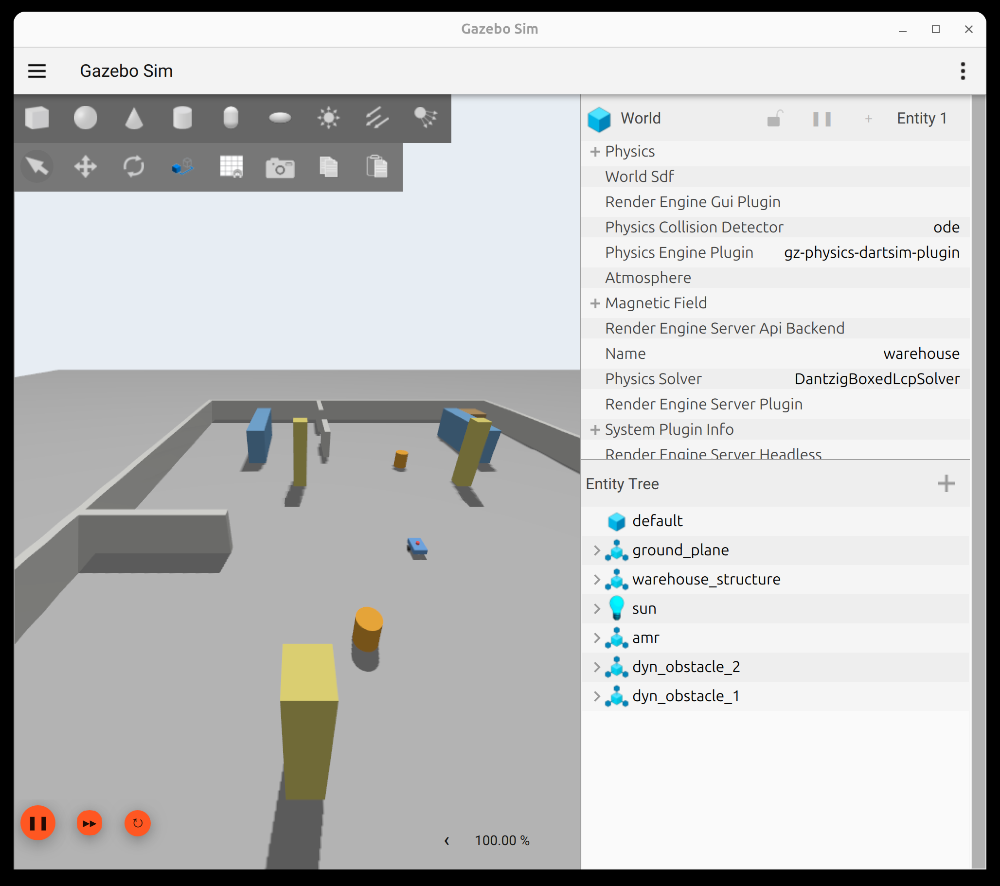
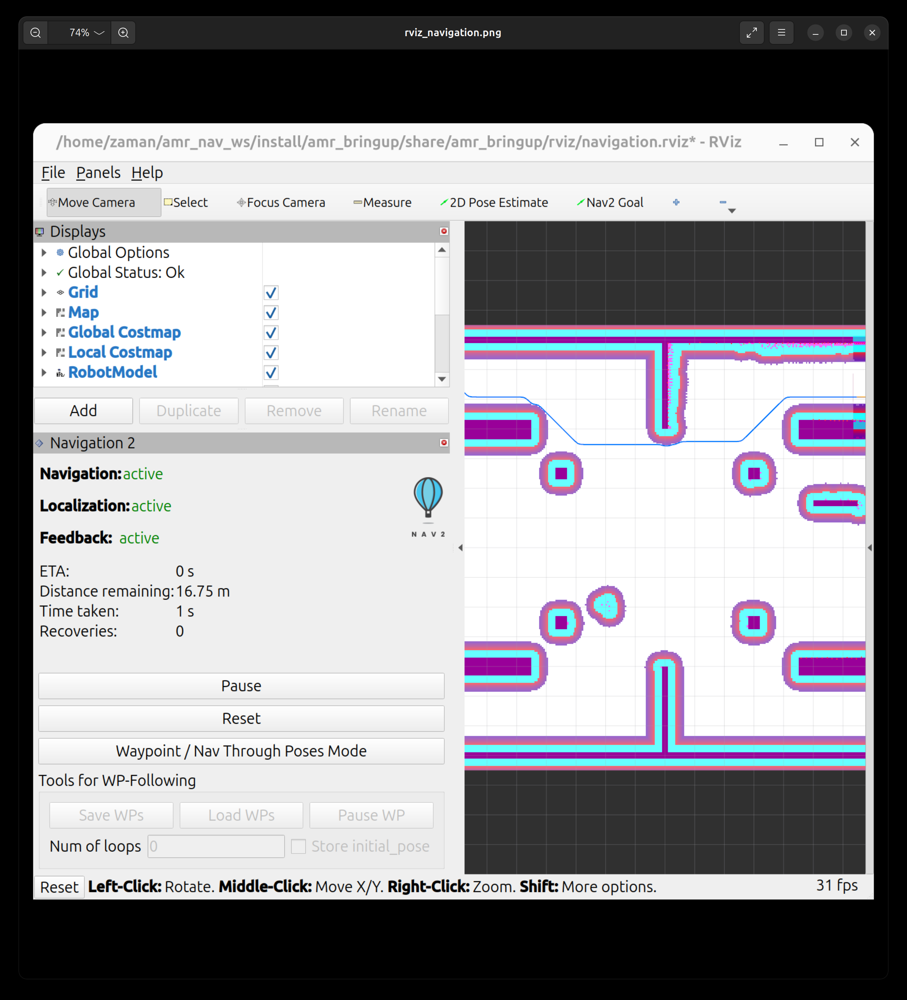
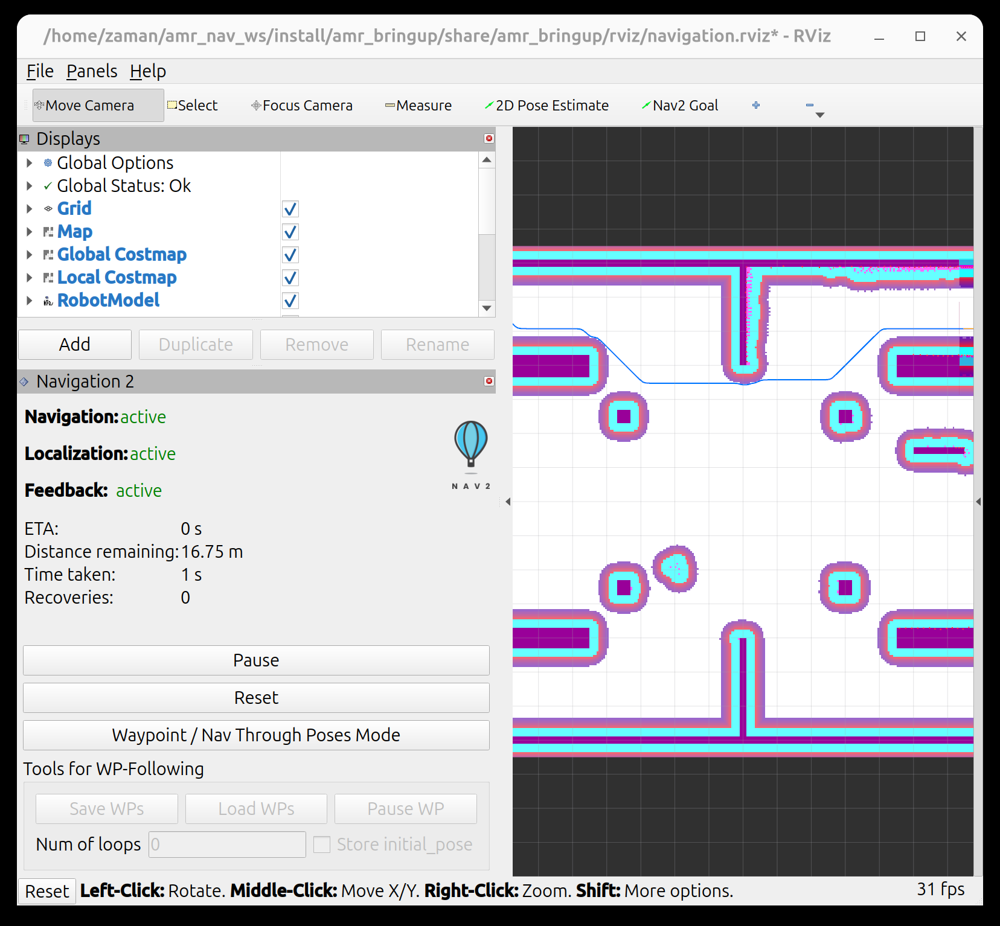
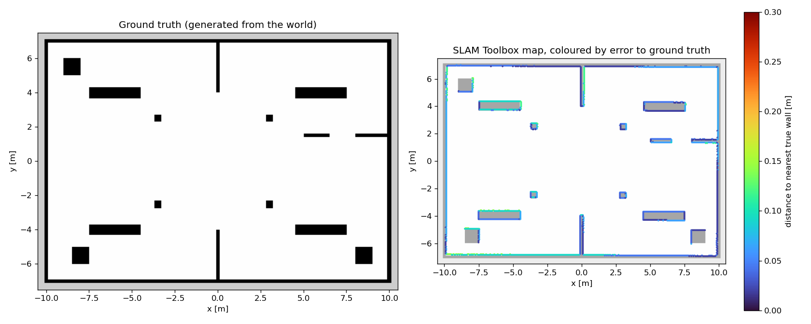
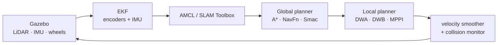

<div align="center">

# Autonomous Mobile Robot Navigation
### ROS 2 Jazzy · Gazebo Harmonic · SLAM Toolbox · AMCL · Nav2 · custom A\* & DWA

[](https://github.com/munavirzaman-git/amr-nav-ros2/actions/workflows/ci.yml)


[](LICENSE)

</div>

A complete autonomous navigation system for a differential-drive mobile robot. It covers
wheel-encoder odometry, mapping, localization and navigation among moving obstacles. It also
includes **from-scratch A\* and Dynamic Window Approach planners implemented as Nav2 plugins**,
which are benchmarked against Nav2's own planners.

## Demo

**Gazebo Harmonic: warehouse, robot and moving obstacles**



**RViz: map, costmaps and AMCL particles**



**RViz: A* path (blue) and DWA trajectories (green = chosen)**




## Highlights

- **Encoder-based odometry.** `ros2_control` integrates the wheel joint positions. A
  `robot_localization` EKF fuses this with the IMU yaw rate.
- **Mapping.** SLAM Toolbox builds the map either by teleop or by a fully autonomous coverage
  tour (`auto_mapper`).
- **Localization and navigation.** AMCL and the full Nav2 stack, with a velocity smoother and a
  collision monitor.
- **Layered dynamic obstacle avoidance.**
  - Obstacle layers in both costmaps, cleared by ray tracing as obstacles move.
  - Replanning at 1 Hz.
  - DWA collision checking at 20 Hz.
  - Collision-monitor time-to-collision limiting.
- **Custom planners as real Nav2 plugins.**
  - `AStarPlanner`: cost-aware 8-connected A\* with a constrained smoother.
  - `DWAController`: a classic dynamic window with exact arc rollouts.
  - Both support Nav2 cancellation, speed limits, the standard exceptions and recoveries.
- **Plugin swap at launch:** `planner:=navfn|smac|astar controller:=mppi|dwb|dwa`.
- **Reproducible evaluation.** Planner, end-to-end and SLAM-map-accuracy benchmarks with
  automatic tables and plots.
- **Engineering.** ROS-free algorithm cores with unit tests, CI, Docker, and documentation.

## Quick start

```bash
# Ubuntu 24.04 + ROS 2 Jazzy
sudo apt install -y ros-jazzy-ros-gz ros-jazzy-gz-ros2-control ros-jazzy-ros2-controllers \
  ros-jazzy-navigation2 ros-jazzy-nav2-bringup ros-jazzy-slam-toolbox \
  ros-jazzy-robot-localization ros-jazzy-teleop-twist-keyboard python3-matplotlib

git clone https://github.com/munavirzaman-git/amr-nav-ros2.git ~/amr_nav_ws
cd ~/amr_nav_ws
rosdep install --from-paths src --ignore-src -y
colcon build --symlink-install --cmake-args -DCMAKE_BUILD_TYPE=Release
source install/setup.bash

ros2 launch amr_bringup bringup.launch.py         # A* + DWA, AMCL, moving obstacles
```
Send goals with **Nav2 Goal** in RViz. Or use Docker: [`docker/Dockerfile`](docker/Dockerfile).

## Usage

| Task | Command |
|---|---|
| Navigate (custom planners) | `ros2 launch amr_bringup bringup.launch.py` |
| Navigate (pure Nav2) | `ros2 launch amr_bringup bringup.launch.py planner:=navfn controller:=mppi` |
| Navigate on your SLAM map | `ros2 launch amr_bringup bringup.launch.py map:=$HOME/maps/warehouse_slam.yaml` |
| Map with teleop | `ros2 launch amr_bringup mapping.launch.py` + `ros2 run teleop_twist_keyboard teleop_twist_keyboard` |
| Map autonomously | `ros2 launch amr_bringup bringup.launch.py slam:=true dynamic_obstacles:=false` + `ros2 run amr_tools auto_mapper` |
| Save a SLAM map | `ros2 run amr_bringup save_map.sh ~/maps/warehouse_slam` |
| Full benchmark | `ros2 run amr_bringup run_comparison.sh 3` |
| SLAM map accuracy | `ros2 run amr_tools compare_maps --slam ~/maps/warehouse_slam.yaml --out results/map_eval` |

Launch arguments of `bringup.launch.py`:

| Argument | Default | Options |
|---|---|---|
| `planner` | `astar` | `navfn`, `smac`, `astar` |
| `controller` | `dwa` | `mppi`, `dwb`, `dwa` |
| `slam` | `false` | `true` uses SLAM Toolbox instead of map_server + AMCL |
| `map` | ground-truth map | any map `.yaml` |
| `dynamic_obstacles` | `true` | `false` |
| `headless` | `false` | `true` runs the Gazebo server only |
| `rviz` | `true` | `false` |

## Results

<!-- RESULTS:START -->
### SLAM map accuracy vs ground truth

| metric | value |
|---|---|
| tolerance_m | 0.1 |
| slam_wall_cells | 2546 |
| gt_wall_cells | 3986 |
| mean_error_m | 0.0546 |
| rms_error_m | 0.0625 |
| p95_error_m | 0.1174 |
| max_error_m | 0.1476 |
| precision | 0.9442 |
| recall | 0.6139 |
| f1 | 0.744 |


<!-- RESULTS:END -->

## How it works



- [Architecture](docs/architecture.md): nodes, TF tree, odometry, robot model, plugin selection.
- [Algorithms](docs/algorithms.md): A\* cost model and smoother, DWA window, rollouts and
  objective, with equations.
- [Benchmarking](docs/benchmarking.md): metrics, controlled comparisons, reproduction, caveats.
- [Troubleshooting](docs/troubleshooting.md): known issues and fixes.

## Repository structure

```
├── src/
│   ├── amr_description/   robot URDF/xacro, ros2_control config
│   ├── amr_gazebo/        world, dynamic obstacle model, bridges, world+map generator
│   ├── amr_planners/      A* and DWA: ROS-free cores, Nav2 plugins, gtests
│   ├── amr_tools/         cmd_vel relay, obstacle driver, auto_mapper, benchmarks, compare_maps
│   └── amr_bringup/       launch files, Nav2/AMCL/SLAM/EKF params, maps, RViz, scripts
├── docs/                  architecture, algorithms, benchmarking, troubleshooting, media
├── results/               benchmark CSVs, summaries, plots, map evaluation
├── tools/                 repository utilities (README results updater)
├── docker/                reproducible environment
└── .github/               CI workflow, issue and PR templates
```

## Testing

```bash
colcon test --packages-select amr_planners && colcon test-result --verbose   # 12 gtests
flake8 src/
```

CI runs four checks on every push:
- lint
- a full Jazzy build with the unit tests
- every planner/controller parameter combination
- a self-check of the map-evaluation tool

## Citation

If you use this work, please cite it using [`CITATION.cff`](CITATION.cff) (GitHub's *Cite this
repository* button).

## License

[Apache 2.0](LICENSE).

## Author

**Munavir Zaman P K**: Research Engineer, Autonomous Vehicles / ADAS.
[GitHub](https://github.com/munavirzaman-git) · [ORCID](https://orcid.org/0009-0001-4537-6234)
