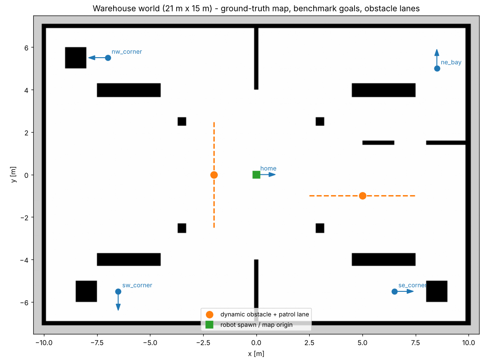
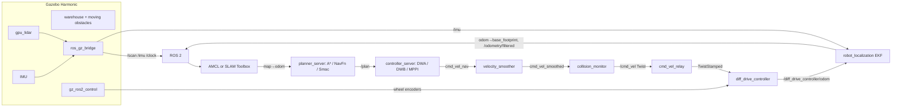

# Autonomous Mobile Robot Navigation — ROS 2 Jazzy + Gazebo Harmonic

A complete differential-drive AMR navigation stack, from wheel encoders to a benchmarked
comparison between Nav2's planners and **custom A\* (global) and DWA (local) planners**
written as real Nav2 plugins.

| Requirement | Where |
|---|---|
| Diff-drive robot, wheel encoders | `amr_description` — ros2_control + `diff_drive_controller` integrating encoder **positions** (`position_feedback: true`), fused with IMU yaw-rate in a `robot_localization` EKF |
| SLAM Toolbox / occupancy grid maps | `amr_bringup/launch/{mapping,slam}.launch.py`, `config/slam_toolbox.yaml`, `scripts/save_map.sh` |
| AMCL localization | `amr_bringup/launch/localization.launch.py` (map_server + AMCL, diff motion model) |
| Nav2 autonomous navigation | `amr_bringup/launch/navigation.launch.py` (all servers + velocity smoother + collision monitor) |
| Global / local costmaps in RViz | `amr_bringup/rviz/navigation.rviz` (map, both costmaps, plans, particles, DWA rollouts, footprint) |
| Dynamic obstacle avoidance | 2 moving obstacles in Gazebo (not in the map) + ray-traced obstacle layers + 1 Hz replanning + DWA + collision monitor |
| Custom global planner (A\*) | `amr_planners::AStarPlanner` (`nav2_core::GlobalPlanner`) |
| Custom local planner (DWA) | `amr_planners::DWAController` (`nav2_core::Controller`) |
| Compare Nav2 vs own planners | `amr_tools`: `planner_benchmark`, `nav_benchmark`, `analyze_results`, `run_comparison.sh` |



---

## 1. Packages

```
amr_nav_ws/src
├── amr_description   URDF/xacro: chassis, 2 drive wheels (encoders), 2 casters, gpu_lidar, IMU, ros2_control
├── amr_gazebo        warehouse.sdf (generated), dynamic_obstacle model, ros_gz_bridge configs,
│                     generate_world_and_map.py (world + pixel-aligned ground-truth map from one spec)
├── amr_planners      C++: GridAStar + DWACore (ROS-free, unit-tested) and the two Nav2 plugin wrappers
├── amr_tools         Python: cmd_vel relay, obstacle driver, planner/navigation benchmarks, analysis
└── amr_bringup       launch files, Nav2/AMCL/SLAM/EKF params, maps, RViz, helper scripts
```

## 2. Data flow



TF tree: `map → odom → base_footprint → base_link → {left,right}_wheel_link, lidar_link, imu_link, casters`
(`map→odom` from AMCL or SLAM Toolbox, `odom→base_footprint` from the EKF).

`cmd_vel_relay` exists because Jazzy's `diff_drive_controller` takes `TwistStamped` while Nav2's
collision monitor and `teleop_twist_keyboard` publish `Twist`.

## 3. Install and build

Ubuntu 24.04 + ROS 2 Jazzy (Gazebo Harmonic is the Jazzy-paired version):

```bash
sudo apt update
sudo apt install -y ros-jazzy-ros-gz ros-jazzy-gz-ros2-control ros-jazzy-ros2-control \
  ros-jazzy-ros2-controllers ros-jazzy-navigation2 ros-jazzy-nav2-bringup \
  ros-jazzy-slam-toolbox ros-jazzy-robot-localization ros-jazzy-xacro \
  ros-jazzy-teleop-twist-keyboard python3-matplotlib python3-yaml

cd ~/amr_nav_ws
rosdep install --from-paths src --ignore-src -y
colcon build --symlink-install --cmake-args -DCMAKE_BUILD_TYPE=Release
source install/setup.bash
colcon test --packages-select amr_planners && colcon test-result --verbose   # 12 algorithm tests
```

## 4. Run

### 4.1 Mapping with SLAM Toolbox (teleop)
```bash
ros2 launch amr_bringup mapping.launch.py               # static world, SLAM, RViz
ros2 run teleop_twist_keyboard teleop_twist_keyboard    # second terminal; drive around slowly
ros2 run amr_bringup save_map.sh ~/maps/warehouse_slam  # writes .pgm/.yaml (+ pose graph)
```
Dynamic obstacles are disabled while mapping so they don't get baked into the map.

**No teleop? Map autonomously** - Nav2 drives a coverage tour while SLAM maps, then saves:
```bash
ros2 launch amr_bringup bringup.launch.py slam:=true dynamic_obstacles:=false   # terminal 1
ros2 run amr_tools auto_mapper --output ~/maps/warehouse_slam                   # terminal 2
```

### 4.2 Navigation with AMCL on a map (default: custom A* + custom DWA)
```bash
ros2 launch amr_bringup bringup.launch.py                                    # prebuilt ground-truth map
ros2 launch amr_bringup bringup.launch.py map:=$HOME/maps/warehouse_slam.yaml # your SLAM map
```
AMCL starts with `set_initial_pose: true` at (0,0,0) = robot spawn. In RViz use **Nav2 Goal**.
If you move the robot by hand, use **2D Pose Estimate** to relocalize.

Swap any planner/controller pair:
```bash
ros2 launch amr_bringup bringup.launch.py planner:=navfn controller:=mppi   # pure Nav2
ros2 launch amr_bringup bringup.launch.py planner:=astar controller:=dwb    # custom global, Nav2 local
ros2 launch amr_bringup bringup.launch.py planner:=smac  controller:=dwa    # Nav2 global, custom local
```

### 4.3 Navigate while mapping
```bash
ros2 launch amr_bringup bringup.launch.py slam:=true
```
The global costmap's static layer subscribes to SLAM Toolbox's `/map`; unknown space is allowed
in planning, so goals can be sent into partially explored areas.

### 4.4 What to look at in RViz
Map, **global costmap** (static + obstacle + inflation, map frame), **local costmap** (4×4 m rolling
window, odom frame), blue global plan, orange local plan, grey DWA candidate rollouts with the
chosen one in green, AMCL particle cloud, footprint. Watch the orange obstacles appear in both
costmaps and clear behind themselves as they move.

## 5. The custom planners

### A\* global planner — `amr_planners::AStarPlanner`
* 8-connected search on the global costmap, **no corner cutting** through diagonal obstacle pairs.
* Cost-aware step cost: `len × (1 + cost_weight · c/252)` ⇒ paths keep away from inflated
  obstacles instead of hugging them. Octile heuristic is admissible because every step costs ≥ 1
  cell; `heuristic_weight > 1` turns it into weighted A\* (faster, sub-optimal).
* Cells with cost ≥ 253 (robot centre inside inscribed radius) are impassable; unknown cells
  optionally allowed with a penalty (needed for SLAM-mode navigation).
* Goal in an obstacle ⇒ nearest free cell within `tolerance`. Start inside inflation is allowed
  (robot parked next to a wall) but not inside a lethal cell.
* Supports Jazzy's planner **cancel checker** and a `max_planning_time` budget, and throws the
  proper `nav2_core` planner exceptions so the BT's recovery logic reacts correctly.
* Post-processing: constrained gradient smoother (data + smoothness terms); any move into a
  higher-cost or lethal cell is rejected, so smoothing can never pull the path into an obstacle.

### DWA local planner — `amr_planners::DWAController`
Classic Fox–Burgard–Thrun DWA for a unicycle:
1. **Dynamic window:** `v ∈ [v₀ − a·Δt, v₀ + a·Δt] ∩ [v_min, v_max]`, same for ω, using the
   measured odometry velocity.
2. **Rollouts:** each (v, ω) sample is integrated with the exact arc solution for `sim_time`.
3. **Admissibility:** a rollout is discarded if any pose falls in a cell ≥ 253 on the local costmap.
4. **Objective** (each term normalised over the admissible set):
   distance to reference path · distance to lookahead target · heading error · max obstacle cost ·
   speed deficit.
5. Supervisory logic: rotate in place when the heading error exceeds `rotate_in_place_angle`,
   linear slow-down inside `approach_dist`, and final alignment to the goal yaw.

It transforms and prunes the global plan in the costmap frame, honours Nav2 speed limits,
publishes `/local_plan` and `/dwa_candidates`, and throws `NoValidControl` when every rollout
collides (Nav2 then runs its clear-costmap / spin / back-up recoveries).

Both algorithms live in ROS-free cores (`astar_core`, `dwa_core`) with 12 gtests covering
optimality in free space, detours, unreachable goals, corner cutting, cost awareness, goal
relocation, smoothing, the dynamic window limit, obstacle rejection, and exact arc integration.

## 6. Dynamic obstacle avoidance — layered
1. **Obstacle layers** in both costmaps mark the LiDAR returns and **ray-trace clear** cells that
   moving obstacles vacate.
2. The default BT **replans at 1 Hz**, so A\* routes around an obstacle blocking a corridor.
3. **DWA** rejects rollouts that intersect the obstacle in the local costmap at 20 Hz.
4. **Collision monitor** (`approach` polygon, 1.2 s horizon on the raw scan) scales the command
   down as a last line of defence, independent of the planners.

Patrol routes and speeds: `amr_gazebo/config/dynamic_obstacles.yaml`.

## 7. Comparing Nav2 with the custom planners

```bash
ros2 run amr_bringup run_comparison.sh 3      # everything, headless; ~30-40 min
```
or step by step with a running stack:

```bash
# (a) Global planners on identical queries and costmap — NavFn, Smac2D and A* are all
#     loaded side by side in planner_server, so one stack is enough:
ros2 run amr_tools planner_benchmark --planners NavFn Smac AStar --repeats 10

# (b) End-to-end tour (5 goals, crosses both obstacle lanes). One run per stack:
ros2 launch amr_bringup bringup.launch.py planner:=navfn controller:=mppi
ros2 run amr_tools nav_benchmark --label navfn_mppi --repeats 3
#   ...relaunch with planner:=astar controller:=dwa, then
ros2 run amr_tools nav_benchmark --label astar_dwa --repeats 3

ros2 run amr_tools analyze_results ~/amr_benchmarks   # summary.md + planners.png + navigation.png
```

| Planner metrics | Navigation metrics |
|---|---|
| success rate, planning time (server-reported and wall), path length, total turning (smoothness), max / mean costmap cost along the path (clearance) | success rate, time to goal, distance travelled, mean speed, minimum LiDAR obstacle distance, mean \|dω/dt\| of the command (jerkiness), recoveries triggered, final position / yaw error |

The fairest controller comparison is **DWA vs DWB** (same algorithm family, same limits and
sample counts in `nav2_params.yaml`); MPPI is included as the stronger Jazzy default. For the
A\* vs NavFn vs Smac comparison, note that NavFn returns a potential-field gradient path
(smooth but can hug inflation), Smac2D is A\*-based with its own smoother, and this A\* trades a
little length for clearance via `cost_weight`. Sweep `cost_weight` (0, 1, 3, 6) to show that
trade-off explicitly in your report.

## 8. Tuning notes
* Robot is modelled as a circle (`robot_radius: 0.28`, half-diagonal of the 0.40×0.28 m body plus
  margin). Both custom planners rely on the inscribed-cost (253) convention, so if you switch to a
  polygon footprint keep `lethal_threshold` at 253 and add footprint checks to DWA.
* DWA: raise `w_obstacle` for more clearance, raise `w_path` to track the global path more tightly,
  lower `sim_time` in narrow doorways. `acc_dt` should be ~ 2–4 controller periods.
* A\*: `cost_weight` sets the length-vs-clearance trade-off; `heuristic_weight` 1.5–2 gives big
  speed-ups on large maps.
* Everything runs on simulated time; every node gets `use_sim_time: true`.

## 9. Regenerating the world
The world and the ground-truth map come from one box list, so they always agree:
```bash
python3 src/amr_gazebo/scripts/generate_world_and_map.py \
  --world src/amr_gazebo/worlds/warehouse.sdf --map src/amr_bringup/maps/warehouse
```

## 10. Troubleshooting
| Symptom | Fix |
|---|---|
| No `/scan` in ROS | world must load `gz-sim-sensors-system` (ogre2); check `gz topic -l` for `/scan` |
| Robot doesn't move | `ros2 control list_controllers` should show both controllers *active*; check `/diff_drive_controller/cmd_vel` is receiving TwistStamped from `cmd_vel_relay` |
| `map` frame missing | localization starts 5 s after Gazebo; on slow machines raise the `TimerAction` periods in `bringup.launch.py` |
| AMCL particles scattered | set the pose with *2D Pose Estimate*; the default initial pose assumes the robot spawned at (0,0,0) |
| Plugin not found | `ros2 pkg prefix amr_planners` and re-source `install/setup.bash`; check `colcon build` output for amr_planners |
| Headless run has no LiDAR | needs `--headless-rendering` (already passed with `headless:=true`) and a working EGL/GPU driver |
