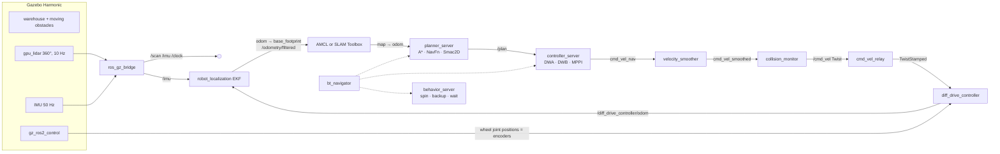

# System architecture

## Nodes and data flow



## TF tree

```
map ──(AMCL / SLAM Toolbox)──▶ odom ──(EKF)──▶ base_footprint ──▶ base_link
                                                                   ├── left_wheel_link / right_wheel_link
                                                                   ├── front_caster_link / rear_caster_link
                                                                   ├── lidar_link
                                                                   └── imu_link
```

## Odometry

`diff_drive_controller` integrates the **wheel joint position** state interfaces
(`position_feedback: true`), i.e. it behaves like a real encoder-based odometry rather than
integrating commanded velocity. Its TF output is disabled; a `robot_localization` EKF in 2D mode
fuses the encoder velocities (vx, vy, vyaw) with the IMU yaw rate and publishes
`odom → base_footprint` and `/odometry/filtered`, which Nav2 uses everywhere.

## Robot

| Parameter | Value |
|---|---|
| Chassis | 0.40 × 0.28 × 0.12 m, 6 kg |
| Drive wheels | r = 0.05 m, separation 0.34 m |
| Casters | 2 frictionless spheres, r = 0.025 m |
| LiDAR | 360 samples, 0.12–12 m, σ = 1 cm, 10 Hz |
| IMU | 50 Hz, gyro σ = 0.002 rad/s |
| Limits | 0.5 m/s, 1.8 rad/s (Nav2); controller hard limits 0.6 m/s, 2.0 rad/s |
| Collision model in Nav2 | circle, r = 0.28 m; inflation 0.55 m |

## Why a cmd_vel relay

In Jazzy, `diff_drive_controller` consumes `geometry_msgs/TwistStamped`, while
`collision_monitor` and `teleop_twist_keyboard` publish `geometry_msgs/Twist`.
`amr_tools/cmd_vel_relay` stamps and forwards the command with simulation time.

## Planner selection at launch

`nav2_params.yaml` holds every candidate configuration (`GridBased_navfn|smac|astar`,
`FollowPath_mppi|dwb|dwa`). `launch/nav_params_util.py` copies the chosen pair into the names the
default behaviour tree expects (`GridBased`, `FollowPath`) and writes an alias-free parameter
file. NavFn, Smac2D and A* are additionally loaded under their own names so the planner
benchmark can query all three against the same costmap in a single stack.
